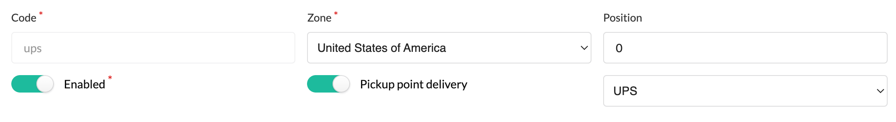

# Sylius plugin for Shipmondo

[![Latest Version][ico-version]][link-packagist]
[![Software License][ico-license]](LICENSE)
[![Build Status][ico-github-actions]][link-github-actions]
[![Code Coverage][ico-code-coverage]][link-code-coverage]

## Installation

```bash
composer require setono/sylius-shipmondo-plugin symfony/webhook
```

### Add plugin class to your `bundles.php`

Make sure you add it before `SyliusGridBundle`.

```php
<?php
$bundles = [
    // ...
    Setono\SyliusShipmondoPlugin\SetonoSyliusShipmondoPlugin::class => ['all' => true],
    Sylius\Bundle\GridBundle\SyliusGridBundle::class => ['all' => true],
    // ...
];
```

### Import routing

```yaml
# config/routes/setono_sylius_shipmondo.yaml
setono_sylius_shipmondo:
    resource: "@SetonoSyliusShipmondoPlugin/Resources/config/routes.yaml"
```

or if your app doesn't use locales:

```yaml
# config/routes/setono_sylius_shipmondo.yaml
setono_sylius_shipmondo:
    resource: "@SetonoSyliusShipmondoPlugin/Resources/config/routes_no_locale.yaml"
```

### Add environment variables

Add the following variables to your `.env` file:

```dotenv
###> setono/sylius-shipmondo-plugin ###
SHIPMONDO_USERNAME=
SHIPMONDO_KEY=
SHIPMONDO_WEBHOOKS_KEY=
SHIPMONDO_SANDBOX=false
###< setono/sylius-shipmondo-plugin ###
```

`SHIPMONDO_WEBHOOKS_KEY` signs the webhooks Shipmondo sends you and must be at least 32 bytes long.
If several shops share a Shipmondo account, give each its own key: the webhooks are named after an id derived from it,
and registering the webhooks in one shop replaces only that shop's.
Set `SHIPMONDO_SANDBOX=true` to use the Shipmondo sandbox instead of the production API.

### Several shops on one Shipmondo account

A sales order's order id is the Sylius order number, and Sylius numbers every shop's orders the same way. If several
shops share a Shipmondo account, give each its own order id prefix, so their sales orders can be told apart, and the
plugin can't mistake another shop's sales order for one of its own when it looks a sales order up by its order id:

```yaml
# config/packages/setono_sylius_shipmondo.yaml
setono_sylius_shipmondo:
    order_id_prefix: 'WEB-' # the order 000001234 becomes the sales order WEB-000001234
```

The prefix shows wherever Shipmondo shows or prints the order id, which may reach customers. It applies only to the
sales orders uploaded after it is set. Don't set or change it while any order's Shipmondo state is `unlinked` or
`uploading_to_shipmondo` (filter the order grid by Shipmondo state to check): the plugin would look their sales orders up
by the new order id, find none, and upload those orders a second time.

### Override template

The shipping method form has to be overridden to be able to edit the `pickupPointDelivery` and `carrierCode` properties on the shipping methods.

If you haven't created the file yet, create `templates/bundles/SyliusAdminBundle/ShippingMethod/_form.html.twig`
and add `{{ form_row(form.pickupPointDelivery) }}` and `{{ form_row(form.carrierCode) }}` where you want it.
An example could be to add it next to the `enabled` field:

```twig
...

<div class="three fields">
    {{ form_row(form.enabled) }}
    {{ form_row(form.pickupPointDelivery) }}
    {{ form_row(form.carrierCode) }}
</div>

...
```

which will look like this in the default admin panel:



### Extend entities

#### `Order` entity

```php
<?php

# src/Entity/Order/Order.php

declare(strict_types=1);

namespace App\Entity\Order;

use Setono\SyliusShipmondoPlugin\Model\OrderInterface as ShipmondoOrderInterface;
use Setono\SyliusShipmondoPlugin\Model\OrderTrait as ShipmondoOrderTrait;
use Sylius\Component\Core\Model\Order as BaseOrder;
use Doctrine\ORM\Mapping as ORM;

/**
 * @ORM\Entity
 *
 * @ORM\Table(name="sylius_order")
 */
class Order extends BaseOrder implements ShipmondoOrderInterface
{
    use ShipmondoOrderTrait;
}
```

#### `PaymentMethod` entity

```php
<?php

# src/Entity/Payment/PaymentMethod.php

declare(strict_types=1);

namespace App\Entity\Payment;

use Doctrine\ORM\Mapping as ORM;
use Setono\SyliusShipmondoPlugin\Model\PaymentMethodInterface as ShipmondoPaymentMethodInterface;
use Setono\SyliusShipmondoPlugin\Model\PaymentMethodTrait as ShipmondoPaymentMethodTrait;
use Sylius\Component\Core\Model\PaymentMethod as BasePaymentMethod;

/**
 * @ORM\Entity
 *
 * @ORM\Table(name="sylius_payment_method")
 */
class PaymentMethod extends BasePaymentMethod implements ShipmondoPaymentMethodInterface
{
    use ShipmondoPaymentMethodTrait;
}
```

#### `ShippingMethod` entity

```php
<?php

# src/Entity/Shipping/ShippingMethod.php

declare(strict_types=1);

namespace App\Entity\Shipping;

use Doctrine\ORM\Mapping as ORM;
use Setono\SyliusShipmondoPlugin\Model\ShippingMethodInterface as ShipmondoShippingMethodInterface;
use Setono\SyliusShipmondoPlugin\Model\ShippingMethodTrait as ShipmondoShippingMethodTrait;
use Sylius\Component\Core\Model\ShippingMethod as BaseShippingMethod;

/**
 * @ORM\Entity
 *
 * @ORM\Table(name="sylius_shipping_method")
 */
class ShippingMethod extends BaseShippingMethod implements ShipmondoShippingMethodInterface
{
    use ShipmondoShippingMethodTrait;
}
```

#### `Shipment` entity

```php
<?php

# src/Entity/Shipping/Shipment.php

declare(strict_types=1);

namespace App\Entity\Shipping;

use Doctrine\ORM\Mapping as ORM;
use Setono\SyliusShipmondoPlugin\Model\ShipmentInterface as ShipmondoShipmentInterface;
use Setono\SyliusShipmondoPlugin\Model\ShipmentTrait as ShipmondoShipmentTrait;
use Sylius\Component\Core\Model\Shipment as BaseShipment;

/**
 * @ORM\Entity
 *
 * @ORM\Table(name="sylius_shipment")
 */
class Shipment extends BaseShipment implements ShipmondoShipmentInterface
{
    use ShipmondoShipmentTrait;
}
```

### Update your database:

```bash
php bin/console doctrine:migrations:diff
php bin/console doctrine:migrations:migrate
```

### Register the webhooks

Register the webhooks the plugin handles with Shipmondo, with the "Register webhooks" button on the admin's Shipmondo
page or on the command line:

```bash
php bin/console setono:sylius-shipmondo:register-webhooks
```

Both register them right away, whatever your Messenger routing, and say how it went: the button with a flash message,
the command in its output and exit code.

Registering compares the shop's webhooks in Shipmondo with the ones the plugin handles (one per action its webhook
handlers handle), and fixes only the difference: it creates the missing ones, including any Shipmondo has deactivated
or sends to another address, deletes the ones no longer wanted and any duplicates, and leaves the rest. When nothing
differs, it only fetches them. Then it records where it registered them, and when, which the Shipmondo page shows along
with whether the shop's webhooks in Shipmondo still match.

**Schedule the command daily**, e.g. with cron, and run it on deploy, next to your database migrations. It only fixes
what differs, so an upgrade that changes the webhooks the plugin handles, or a webhook deleted or deactivated in
Shipmondo, is fixed by its next run. When nothing differs, it makes one request. Where the command can't ask which
hostname to use, pass `--hostname` if your channels have several:

```bash
php bin/console setono:sylius-shipmondo:register-webhooks --no-interaction --hostname=shop.example.com
```

Shipmondo sends the webhooks to the shop's webhook endpoint, `/webhook/shipmondo`. The admin's button registers it at
the host the admin is on. On the command line there is no request to take the host from, so the command registers it
at:

1. `https://<hostname>`, for the hostname passed with `--hostname`, e.g. `--hostname=shop.example.com` registers
   `https://shop.example.com/webhook/shipmondo`;
2. else `https://<hostname>`, for the enabled channels' hostname. When the channels have several, the command asks
   which one, or, when it can't ask (e.g. with `--no-interaction` in a deploy script), fails and lists them: pass one
   with `--hostname`;
3. else the router's default URI, `framework.router.default_uri`, path included.

A hostname is registered at its root, on https's own port: the port and path of `framework.router.default_uri` are
not added to it.

It skips a hostname Shipmondo can't reach, such as `localhost` (the hostname Sylius's fixtures give a channel), a name
under `localhost` or a `127.x.x.x` address, and one that isn't a hostname, e.g. with a port or a scheme. When it finds
none, it fails without registering, and the webhooks registered before are kept.

The button follows the same rule: on an admin opened at such a host, e.g. `http://localhost:8000` or the
`https://127.0.0.1:8000` of `symfony serve`, it registers nothing and says why, and the webhooks registered before are
kept.

> [!WARNING]
> **Running a copy of the shop locally?** Registering replaces the shop's webhooks: the ones named with its shop id,
> which comes from `SHIPMONDO_WEBHOOKS_KEY`. The rule above only catches `localhost` and loopback addresses. Other
> local addresses pass it, such as `shop.test` (Laravel Valet), `shop.ddev.site` (DDEV) or a LAN address like
> `192.168.1.20`. With the production credentials and webhooks key, e.g. in a copy of the production `.env`,
> registering there replaces the production shop's working webhooks with ones Shipmondo can't deliver. Locally, give
> the shop a `SHIPMONDO_WEBHOOKS_KEY` of its own, or a Shipmondo sandbox account (`SHIPMONDO_SANDBOX=true` with its
> credentials). The same goes for a staging copy of production that registers the webhooks, e.g. from its own scheduled
> command: with the same webhooks key, each install's registration replaces the other's webhooks. Give it a key of its
> own.

## Cancelled orders and asynchronous deletion

When an order is cancelled in Sylius, the plugin deletes its sales order in Shipmondo through the `DeleteOrder` command
on the `setono_sylius_shipmondo.command_bus` bus. It is handled synchronously by default, and a failing Shipmondo call
never fails the cancellation: the admin is told to delete the sales order in Shipmondo, and the failure is logged.

To delete the sales order in a worker instead, route the command to an asynchronous transport:

```yaml
# config/packages/messenger.yaml
framework:
    messenger:
        routing:
            'Setono\SyliusShipmondoPlugin\Message\Command\DeleteOrder': async
```

A worker retries a deletion that fails temporarily (a Shipmondo server error or a network problem) or is rate limited,
with the transport's own retry strategy; the plugin configures none. A deletion that trying again won't change (e.g.
Shipmondo doesn't accept the credentials) goes straight to the failure transport, as does one that runs out of
retries, so watch the failure transport:

```shell
php bin/console messenger:failed:show
```

A failed deletion is not retried, only logged, when it is handled inside a database transaction other than the command
bus's own: when `DeleteOrder` is routed to `sync://`, and when a worker wraps the handling of messages in a transaction
of its own.

## Development

```shell
(cd tests/Application && yarn install)
(cd tests/Application && yarn build)
(cd tests/Application && bin/console assets:install)

(cd tests/Application && bin/console doctrine:database:create)
(cd tests/Application && bin/console doctrine:schema:create)

(cd tests/Application && bin/console sylius:fixtures:load -n)

(cd tests/Application && symfony serve -d)

vendor/bin/expose token <your expose token>
vendor/bin/expose default-server free # If you are not paying for Expose
vendor/bin/expose share https://127.0.0.1:8000
```

[ico-version]: https://poser.pugx.org/setono/sylius-shipmondo-plugin/v/stable
[ico-license]: https://poser.pugx.org/setono/sylius-shipmondo-plugin/license
[ico-github-actions]: https://github.com/Setono/SyliusShipmondoPlugin/actions/workflows/build.yaml/badge.svg
[ico-code-coverage]: https://codecov.io/gh/Setono/SyliusShipmondoPlugin/branch/2.x/graph/badge.svg

[link-packagist]: https://packagist.org/packages/setono/sylius-shipmondo-plugin
[link-github-actions]: https://github.com/Setono/SyliusShipmondoPlugin/actions
[link-code-coverage]: https://codecov.io/gh/Setono/SyliusShipmondoPlugin
